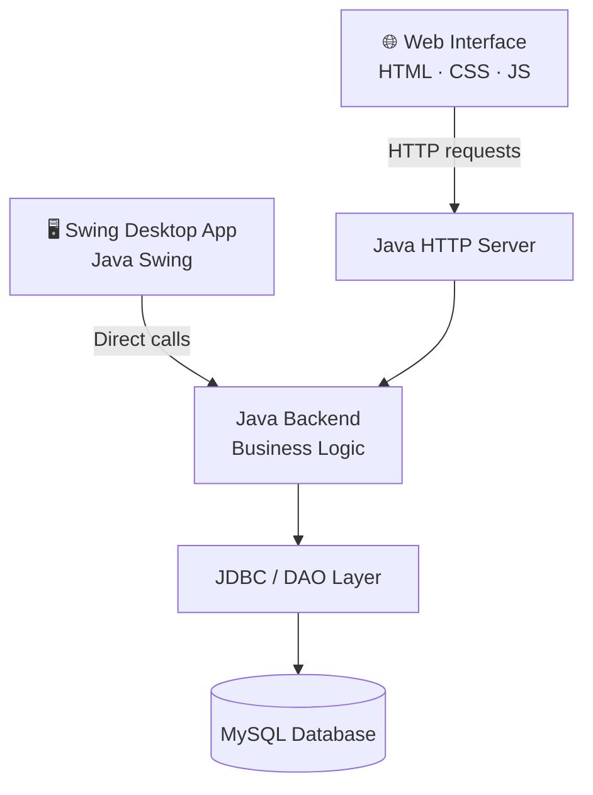
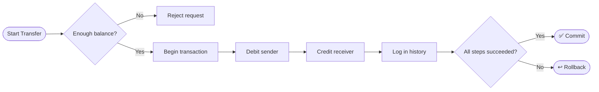

<div align="center">

# 🏦 SECURE BANK

### *Every rupee accounted for. Every transaction safe.*

A Java-powered banking transaction system with a **web dashboard**, a **Swing desktop app**, and a **MySQL** core, all running on one backend.

<br>


<br>

[Features](#-what-it-does) • [Architecture](#-how-its-built) • [Quick Start](#-quick-start) • [Concepts](#-what-this-project-teaches) • [Team](#-the-team) • [Roadmap](#-roadmap)

</div>

---

## 💡 The Idea

Most student banking projects stop at a console menu. **Secure Bank** goes further: it puts customers and administrators on separate, purpose-built modules, connects them to a real relational database, and lets you use the same system from either a **browser** or a **desktop window**.

One backend. Two front doors. Zero guesswork about where your money went.

---

## 🎯 What It Does

<table>
<tr>
<td width="33%" valign="top">

### 👤 Customer
Everyday banking, made simple.

- 🔐 Secure login
- 💰 Check balance
- ➕ Deposit
- ➖ Withdraw
- 🔁 Transfer funds
- 📜 Transaction history

</td>
<td width="33%" valign="top">

### 🛡️ Admin
Full visibility over the bank.

- 🔐 Admin login
- 👥 View all customers
- 🔎 Monitor transactions
- 🆕 Add accounts
- 🗑️ Delete accounts
- 🏛️ Total bank balance

</td>
<td width="33%" valign="top">

### ⚙️ Engine
What keeps it trustworthy.

- ✅ Balance validation
- 🧾 History logging
- 🔒 Atomic transactions
- ↩️ Commit & rollback
- 🛑 Prepared statements

</td>
</tr>
</table>

---

## 🧩 How It's Built

Two interfaces, one shared brain:



### 🔄 How a Transfer Stays Safe



If anything fails halfway, the database rolls back, so money is never debited without being credited.

---

## 🧰 Tech Stack

| Layer | Technology | Role |
|:--|:--|:--|
| 🧠 Backend | **Java** | Core logic and processing |
| 🖥️ Desktop UI | **Java Swing** | Native desktop client |
| 🌐 Web Server | **Java HTTP Server** | Serves the site and handles API calls |
| 🔌 Connectivity | **JDBC** | Java ↔ database bridge |
| 🗄️ Database | **MySQL** | Accounts, balances, transaction records |
| 🎨 Frontend | **HTML5 · CSS3 · JavaScript** | Interactive browser experience |

---

## 📂 Project Layout

```text
Secure_Bank/
├── src/                    ← Java source
│   ├── Account Management
│   ├── Transaction Management
│   ├── Database Connectivity
│   └── Dashboard Modules
│
├── web/                    ← Browser interface
│   ├── index.html
│   ├── style.css
│   ├── app.js
│   └── fx.js
│
├── lib/                    ← MySQL Connector/J goes here
├── run.bat                 ← One-click launch (Windows)
├── run.sh                  ← One-click launch (Linux / macOS)
├── WEB_UI_README.md        ← Web UI notes
└── README.md
```

---

## ⚡ Quick Start

### 📋 You'll need

- ☕ Java JDK
- 🐬 MySQL Server
- 🔌 MySQL Connector/J

### 🛠️ Setup

**1. Clone and enter the project**

```bash
git clone YOUR_REPOSITORY_URL
cd Secure_Bank
```

**2. Prepare the database**

- Start MySQL Server
- Create the banking database
- Create the required tables
- Set your database credentials as **environment variables** (never hard-code them)

**3. Add the driver**

Drop the MySQL JDBC Connector `.jar` into the `lib/` folder.

**4. Launch**

<details open>
<summary><b>🪟 Windows</b></summary>

```bash
run.bat
```
</details>

<details>
<summary><b>🐧 Linux / 🍎 macOS</b></summary>

```bash
chmod +x run.sh
./run.sh
```
</details>

**5. Open the app**

```text
http://localhost:8080
```

---

## 🎓 What This Project Teaches

| Area | Concepts |
|:--|:--|
| 🧱 **Java Fundamentals** | OOP, classes and objects, encapsulation, exception handling |
| 🗄️ **Databases** | JDBC, SQL operations, prepared statements, commit and rollback |
| 🌐 **Integration** | Frontend ↔ backend communication, HTTP |

---

## 👥 The Team

| Role | Contributor |
|:--|:--|
| 🧑‍💻 Project Developer | Your Name |
| 🤝 Team Member | Friend 1 |
| 🤝 Team Member | Friend 2 |

---

## 🔮 Roadmap

- [ ] 🔐 Stronger authentication and password security
- [ ] 📊 Detailed financial analytics
- [ ] 👤 Account profile management
- [ ] 🔔 Transaction notifications
- [ ] 🧾 Advanced transaction reports
- [ ] ☁️ Cloud deployment

---

## ⚠️ Disclaimer

> **Secure Bank is an academic project** built for learning and demonstration. It is **not** intended for real banking operations or real financial transactions.

---

<div align="center">

**🏦 SECURE BANK**
*Smarter banking. Simpler transactions.*

⭐ If you found this project useful, consider giving it a star!

</div>
